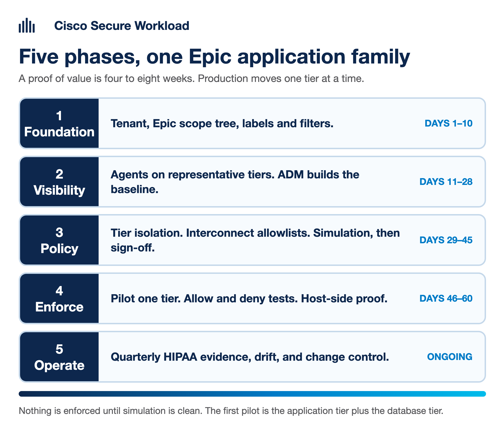
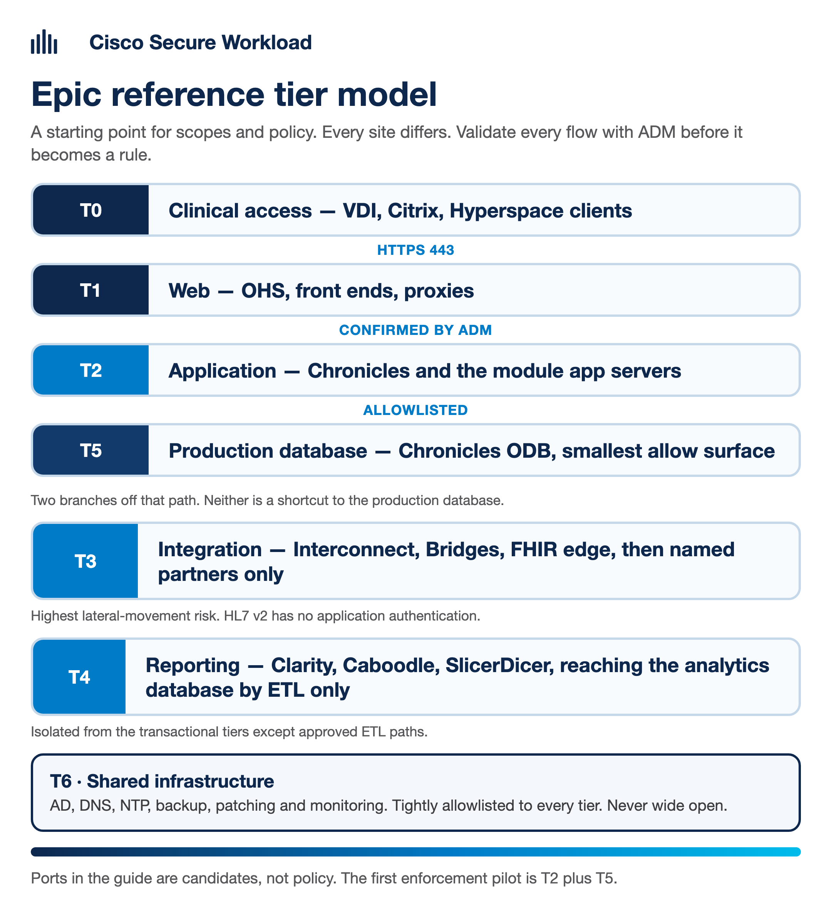
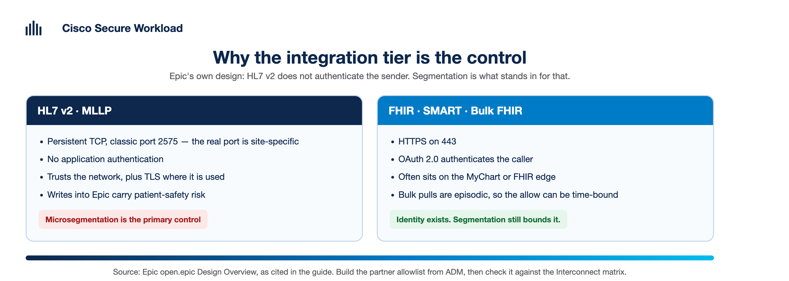

# Cisco Secure Workload — Epic EHR Microsegmentation Guide


A **step-by-step practitioner guide** for microsegmenting **Epic** electronic
health record (EHR) environments with **Cisco Secure Workload (CSW)** —
from first agent install through ADM baseline, policy simulation, enforcement,
and HIPAA-aligned evidence packs.

Written for healthcare security engineers, Epic platform teams, and POV teams
who need a repeatable path from *"we see flows"* to *"we enforce least-privilege
between Epic tiers and prove it for audit"*.

> **Status.** Draft v1 (July 2026). Patterns reflect CSW 4.0 / 3.10 workflows
> and common Epic deployment models. **Every Epic site is different** — ports,
> hostnames, and module mix vary. Treat port tables here as *candidates to
> validate with ADM*, not as gospel. Cross-check release-specific behaviour in
> the [Cisco Secure Workload User Guide](https://www.cisco.com/c/en/us/support/security/workload-security/products-user-guide-list.html)
> and your Epic Technical Services team.

> **Disclaimer.** Independent community reference — not an official Cisco or
> Epic Systems publication.

---

## For executives — at a glance

| Question | Answer |
|----------|--------|
| **What problem does this solve?** | Epic estates sprawl across web, app, database, analytics, and interface tiers. Flat VLANs cannot prove ePHI isolation. CSW observes real traffic and enforces host-level policy per workload. |
| **What is the rollout sequence?** | Foundation → Visibility (ADM) → Policy modeling (Simulation) → Enforcement (pilot tier) → Operations (evidence + change control). |
| **How long?** | POV: 4–8 weeks for one Epic application family. Production: phased over quarters by tier. |
| **What evidence does audit get?** | Live dependency maps, policy exports, denied-connection logs, quarterly inventory snapshots — mapped to HIPAA §164.312 and related controls. |
| **What does CSW not replace?** | BAAs, encryption key management, physical access, Epic application RBAC, or formal pen tests. |

---

## What's in this repo

```
CSW-Epic-Microsegmentation-Guide/
├── README.md                         ← you are here
├── INDEX.md                          ← jump table by question / phase
├── docs/
│   ├── 00-official-references.md     ← Cisco + Epic doc pointers
│   ├── 01-epic-architecture-tiers.md ← tier model + typical ports
│   ├── 02-csw-primer-healthcare.md   ← CSW terms for clinical teams
│   └── 03-prerequisites.md           ← accounts, ports, change windows
├── phase-1-foundation/               ← tenant, scopes, labels
├── phase-2-visibility/               ← agents, ADM, flow baseline
├── phase-3-policy-modeling/          ← tier policies, Interconnect, simulation
├── phase-4-enforcement/              ← enforce sequence, tests, host proof
├── phase-5-operations/               ← HIPAA pack, change mgmt, troubleshooting
├── validation/                       ← POV test plan + evidence matrix
└── docs/_build/build_docx.sh         ← pandoc → .docx hand-off
```

---

## Five phases



[1 · Foundation](./phase-1-foundation/README.md) · [2 · Visibility](./phase-2-visibility/README.md) · [3 · Policy](./phase-3-policy-modeling/README.md) · [4 · Enforce](./phase-4-enforcement/README.md) · [5 · Operate](./phase-5-operations/README.md)

Running a proof of value? Start with the [test plan](./validation/01-pov-test-plan.md). The audit mapping lives in [CSW-Compliance-Mapping](https://github.com/chandrapati/CSW-Compliance-Mapping) — [HIPAA](https://github.com/chandrapati/CSW-Compliance-Mapping/tree/main/HIPAA) and [HITRUST](https://github.com/chandrapati/CSW-Compliance-Mapping/tree/main/HITRUST-CSF). This repo is how the Epic tiers get built; those are what an assessor is shown.

---

## Epic tier model (high level)



*T0 clinical access reaches T5, the production database, only through the web and application tiers. Integration and reporting branch off that path and are isolated from it. Ports in this guide are candidates — confirm each one with ADM.*

Detail, including the port table and the scope tree: [`docs/01-epic-architecture-tiers.md`](./docs/01-epic-architecture-tiers.md)

## Why the integration tier matters



Epic's own design overview says HL7 v2 over TCP **will not rely on authentication** — it relies on other security mechanisms, which in practice means the network plus TLS where it is used. For that traffic, microsegmentation is the control rather than a complement to one. FHIR and SMART authenticate with OAuth 2.0, so the job there is bounding an identity that already exists.

How to build the partner allowlist: [`phase-3-policy-modeling/02-interconnect-and-hl7.md`](./phase-3-policy-modeling/02-interconnect-and-hl7.md)

---

## Related public guides (same author)

| Repo | Use when |
|------|----------|
| [CSW-Compliance-Mapping](https://github.com/chandrapati/CSW-Compliance-Mapping) | **Start here for audit** — HIPAA §164.312, HITRUST, NIST control mapping and quarterly evidence playbook |
| [CSW-Policy-Lifecycle](https://github.com/chandrapati/CSW-Policy-Lifecycle) | ADM → publish → enforce deep dive (companion to Phase 3–4) |
| [CSW-Identity-Integration-Guide](https://github.com/chandrapati/CSW-Identity-Integration-Guide) | Scope policy on AD / Entra users and clinical identity |
| [CSW-Agent-Installation-Guide](https://github.com/chandrapati/CSW-Agent-Installation-Guide) | SCCM / Ansible agent rollout on Epic hosts |
| [csw-secure-connector](https://github.com/chandrapati/csw-secure-connector) | Private Epic subnets without inbound 443 |
| [CSW-POV-Tooling](https://github.com/chandrapati/CSW-POV-Tooling) | API scripts + agent log-bundle analysis |

### Compliance mapping — healthcare focus

| Framework | Runbook | How this Epic guide uses it |
|-----------|---------|-------------------------------|
| [HIPAA Security Rule](https://github.com/chandrapati/CSW-Compliance-Mapping/tree/main/HIPAA) | [Technical runbook](https://github.com/chandrapati/CSW-Compliance-Mapping/blob/main/HIPAA/CSW-HIPAA-Technical-Runbook.md) | Phase 5 quarterly pack → §164.312 evidence |
| [HIPAA 2025 NPRM](https://github.com/chandrapati/CSW-Compliance-Mapping/tree/main/HIPAA-2025-NPRM) | [NPRM runbook](https://github.com/chandrapati/CSW-Compliance-Mapping/blob/main/HIPAA-2025-NPRM/CSW-HIPAA-NPRM-Technical-Runbook.md) | Proposed mandatory segmentation narrative |
| [HITRUST CSF v11](https://github.com/chandrapati/CSW-Compliance-Mapping/tree/main/HITRUST-CSF) | [HITRUST runbook](https://github.com/chandrapati/CSW-Compliance-Mapping/blob/main/HITRUST-CSF/CSW-HITRUST-Technical-Runbook.md) | Harmonized HIPAA + ISO evidence |
| [NIST CSF 2.0](https://github.com/chandrapati/CSW-Compliance-Mapping/tree/main/NIST-CSF-2) | [CSF runbook](https://github.com/chandrapati/CSW-Compliance-Mapping/blob/main/NIST-CSF-2/CSW-CSF-Technical-Runbook.md) | PR.IR segmentation maturity |
| [Compliance evidence playbook](https://github.com/chandrapati/CSW-Compliance-Mapping/blob/main/docs/compliance-evidence-playbook.md) | Universal 4-phase programme | Overlaps Phase 1–5 checklists here |
| [Framework scope design](https://github.com/chandrapati/CSW-Compliance-Mapping/blob/main/docs/framework-scope-design.md) | Workshop aid | `ePHI-Zone` / `EHR` scope patterns → Epic tier tree |

> **Suggested healthcare journey:**  
> [Compliance evidence playbook](https://github.com/chandrapati/CSW-Compliance-Mapping/blob/main/docs/compliance-evidence-playbook.md) → **CSW-Epic-Microsegmentation-Guide** → [HIPAA runbook](https://github.com/chandrapati/CSW-Compliance-Mapping/blob/main/HIPAA/CSW-HIPAA-Technical-Runbook.md) → [CSW-Policy-Lifecycle](https://github.com/chandrapati/CSW-Policy-Lifecycle)

---

## Contributing

Issues and PRs welcome. Do **not** submit customer hostnames, flow exports,
or credentials. Anonymize all examples.

## License

[MIT](./LICENSE)
